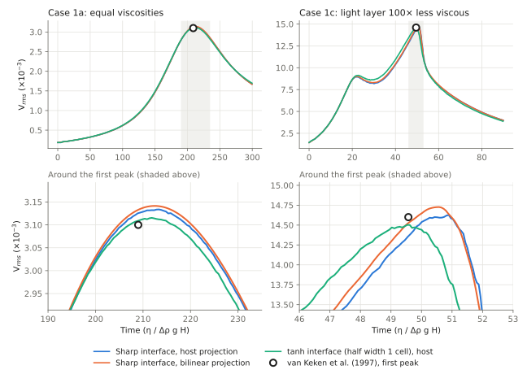

# Benchmarks and verification

MILET's verification story has three layers: fast **smoke tests** that pin
the pointwise physics to analytic results, **solver gates** that require the
iterative and reduced formulations to reproduce the direct/reference
solution to tight tolerances, and **community benchmarks** (SolCx,
Blankenbach, King et al. 2010, van Keken et al. 1997, Glerum, Busse) with published reference values. Everything
below lives in `test/` and runs against the same source files as production
(`test/runtests.jl` includes the identical module graph as `main.jl`).

```bash
# smoke + solver gates (minutes)
julia --project=. test/runtests.jl

# additionally run the short physics benchmarks
RUN_BENCHMARKS=1 julia --project=. test/runtests.jl

# convergence studies (longer)
julia --project=. test/validation/solcx_convergence.jl
julia --project=. test/validation/blankenbach_convergence.jl
julia --project=. -t 4 test/validation/vankeken_rt.jl 1a 65 97

# laptop-budget long bench (≈ 30–45 min)
julia --project=. test/long_bench.jl
```

## SolCx — variable-viscosity Stokes convergence

`test/validation/solcx_convergence.jl` runs the SolCx benchmark (Duretz et
al. 2011) — a sharp 10⁶ viscosity jump at x = 0.5 with the analytic body
force $\rho g_y = \sin(\pi y)\cos(\pi x)$ and free-slip walls — at
nx = 33, 65, 129 and estimates the convergence order of $|v|_{\max}$ by
Richardson extrapolation between successive refinements (h halves → an
error ratio of 4 implies second order). The reference peak velocity is
$|v|_{\max} \approx 6.9\times10^{-9}$. The case definitions are
`cases/solcx.toml` and the fixed-resolution series
`cases/solcx_fixed_n24…n128.toml`; the short gated variant
(`test/benchmarks/run_solcx.jl`, `RUN_BENCHMARKS=1`) asserts finiteness and
brackets `vmax`. Because the viscosity jump is **element-aligned** for even
cell counts, this benchmark exercises exactly the discontinuous-coefficient
regime the Q2/Q1 Taylor–Hood pair (see
[Discretization](../numerics/discretization.md)) must handle.

## Blankenbach 1A — thermal convection references

`test/validation/blankenbach_convergence.jl` runs Case 1A of Blankenbach et
al. (1989) — isoviscous Ra = 10⁴ convection, nondimensional unit box — at
nx = 41/61/81 to quasi-steady state and compares against the canonical
steady-state references:

```math
\mathrm{Nu} = 4.884, \qquad V_{\rm rms} = 42.86.
```

Both diagnostics are FE-integral-accurate (`nusselt` and `vrms` in
`src/io/Diagnostics.jl`): Nu is computed as
$\mathrm{Nu} = \langle \partial T/\partial y\rvert_{y=0}\rangle\, H/\Delta T$
(positive in MILET's y-down convention) over the surface boundary measure,
and $V_{\rm rms} = \sqrt{\int u\cdot u\, d\Omega / |\Omega|}$. The script
prints the percent error per resolution. The benchmark validates the entire
PIC heat-transport loop — `marker_T_mode = "pic_increment"` (markers carry
and advect temperature, the FE step supplies the diffusion increment) plus
the `buoyancy_from_T` Stokes coupling. The `cases/blankenbach_sg_n41/65/97`
series repeats the study with Gerya & Yuen (2003) subgrid diffusion enabled
(`do_subgrid_diffusion = true`). The 3D analogue is `cases/busse_1a.toml` (Busse et al. 1993:
Nu ≈ 3.539, V_rms ≈ 40.999).

### Grid study with subgrid diffusion

Case 1A with markers carrying temperature and the full Gerya & Yuen (2003)
subgrid scheme (`subgrid_scheme = "gerya_yuen"`, the default). The values
are averages over the last fifth of each run.

| Run | Nu (4.884) | V_rms (42.865) | V_surf | mobility |
|---|---|---|---|---|
| 41 × 41 | 4.772 (−2.3 %) | 42.77 (−0.22 %) | 45.27 | 1.06 |
| 65 × 65 | 4.829 (−1.1 %) | 42.81 (−0.13 %) | 45.33 | 1.06 |
| 97 × 97 | 4.851 (−0.68 %) | 42.84 (−0.07 %) | 45.37 | 1.06 |
| 65 × 65, Eulerian SUPG solve, no markers | 4.853 (−0.63 %) | 42.83 (−0.08 %) | 45.36 | 1.06 |
| 65 × 65, legacy `"reproject"` scheme | 4.603 (−5.8 %) | 44.81 (+4.5 %) | 47.32 | 1.06 |

- **Convergence:** the Nu error falls with grid spacing at an order of about 1.2–1.6. Richardson extrapolation gives Nu ≈ 4.878, about −0.1 %. V_rms is within 0.25 % on every grid.
- **Where the remaining Nu error comes from:** the Eulerian solve without markers has the same offset on the same grid. So the remaining Nu error comes from resolving the thermal boundary layer and from computing Nu from the surface temperature gradient, not from the marker coupling.
- **Legacy scheme:** the old `"reproject"` variant stays about 5 % off at every resolution, and it drifts laterally in a static conductive lid by tens of kelvin. With `"gerya_yuen"` the same lid keeps its lateral temperature uniform to within 0.1 K. Keep `"reproject"` only to reproduce old runs.
- **Plain Boussinesq on the TALA code:** the Boussinesq path gives the same 65 × 65 values (Nu 4.830, V_rms 42.80).

## King et al. (2010) — TALA compressible convection

`cases/king2010_tala_Ra1e4_Di{025,050,100}.toml` run the TALA cases of King
et al. (2010) at Ra = 10⁴ and Di = 0.25, 0.5, 1 (unit box, 65 × 65, markers
with subgrid diffusion, $\gamma_r = 1$, surface temperature 0.091). They are
compared with the converged ASPECT values (King et al. 2010 as tabulated in
Heister et al. 2017; the same numbers are in ASPECT's
`benchmarks/king2dcompressible`). `cases/tala_boussinesq_limit_Ra1e4.toml`
runs TALA at Di = 10⁻⁶, which must reproduce Blankenbach 1A.

| Case | Nu | V_rms |
|---|---|---|
| Di = 10⁻⁶ (Boussinesq limit) | 4.846 (plain Boussinesq on the same grid: 4.830) | 42.80 (42.80) |
| Di = 0.25 | −1.0 % | −0.3 % |
| Di = 0.5 | −2.0 % | −0.5 % |
| Di = 1, long run (t = 1.1) | 2.515 (−2.0 %; ASPECT 2.566) | 25.77 (−1.0 %; ASPECT 26.03) |
| Di = 1, Eulerian solve without markers | 2.543 (−0.9 %) | 25.86 (−0.65 %) |

The mean temperature agrees with ASPECT to within 0.001 at every Di. The
Eulerian solve is within 1 % of ASPECT, which is the accuracy of the same
solver for Boussinesq convection on this grid. Carrying temperature on
markers adds a further low bias that grows with Di. For the planetary
dissipation numbers MILET is used at (Di ≈ 0.1), the error is below the
Di = 0.25 values.

## van Keken et al. (1997) — Rayleigh–Taylor instability

Case 1 of van Keken et al. (1997) tests how markers carry a density
interface. It is a Rayleigh–Taylor instability: a dense layer over a light
one, with no temperature. The flow is driven only by the density difference,
so the result depends on how well the markers represent the interface.

**Setup** (`cases/vankeken1997_1a/1b/1c.toml`):

- **Box:** λ × 1 with λ = 0.9142, the most unstable wavelength.
- **Layers:** a light layer below the interface at height
  $0.2 + 0.02\cos(\pi x/\lambda)$ above the floor; MILET's y axis points
  down, so the light layer is $y > 1 - h(x)$ (`rock_type_vankeken`).
- **Units:** density contrast, gravity, layer thickness and the dense-layer
  viscosity are all 1. Time is in units of $\eta/(\Delta\rho\, g H)$.
- **Light-layer viscosity:** 1 in case 1a, 0.1 in 1b, 0.01 in 1c.
- **Boundaries:** no-slip top and bottom (`"uniform"` with zero velocity),
  free-slip sides.
- **Markers:** 4 × 4 per cell. Stokes is solved with Q2–Q1 elements, and
  advection follows the usual CFL limit, with the time step capped at 1.

**Measurement:** `[output] bench_every_step = true` writes $V_{\rm rms}$ to
`bench.csv` every step, stamped with the time of the configuration that
produced it. With the default projection the series rises in small steps,
because a cell's density changes only when a marker crosses into it. So the
first peak is taken as the vertex of a least-squares parabola through all
points within 3 % of the largest value. The run stops before the second peak
(t = 300, 120 and 90 for 1a, 1b and 1c).

```bash
julia --project=. -t 4 test/validation/vankeken_rt.jl 1a 65 97 129    # sharp interface
PROJECTION=bilinear julia --project=. -t 4 test/validation/vankeken_rt.jl 1a 65 97
SMOOTH=1 julia --project=. -t 4 test/validation/vankeken_rt.jl 1a 65 97
```

**Three ways to represent the interface:**

- **Sharp interface, host projection (the default).** Each marker is either
  dense or light. Each cell's density is the mean of the markers inside it
  (`projection_mode = "host"`).
- **Sharp interface, bilinear projection.** Each marker contributes to the
  2 × 2 cells around it, with bilinear weights
  (`projection_mode = "bilinear"`).
- **Smoothed interface, host projection.** As in the ASPECT cookbook, the
  starting light-layer fraction is $C = \tfrac12\,[1 + \tanh(d/w)]$, with d
  the depth below the interface and w one cell height. A marker carries a
  single rock type, so it becomes light with probability C. The draw is a
  deterministic hash of the marker position, so runs repeat exactly
  (`rock_type_vankeken_smooth`).

**First $V_{\rm rms}$ peak.** Each cell gives the peak value and its time,
with the error against the reference in brackets.

| Case (reference) | Grid | Sharp, host | Sharp, bilinear | Smoothed, host |
|---|---|---|---|---|
| 1a (0.0031 at t = 208.99) | 64 × 64 | 0.00312 (+0.5 %) at 212.7 (+1.8 %) | 0.00313 (+1.0 %) at 212.5 (+1.7 %) | 0.00312 (+0.6 %) at 211.4 (+1.1 %) |
| | 96 × 96 | 0.00313 (+1.0 %) at 212.6 (+1.7 %) | 0.00314 (+1.3 %) at 212.6 (+1.7 %) | 0.00311 (+0.3 %) at 211.9 (+1.4 %) |
| | 128 × 128 | 0.00309 (−0.3 %) at 209.7 (+0.3 %) | — | — |
| 1b (0.0095 at t = 71.92) | 64 × 64 | 0.00958 (+0.8 %) at 73.9 (+2.7 %) | — | — |
| | 96 × 96 | 0.00954 (+0.4 %) at 73.8 (+2.7 %) | — | — |
| 1c (0.0146 at t = 49.57) | 64 × 64 | 0.01476 (+1.1 %) at 50.4 (+1.7 %) | 0.01488 (+1.9 %) at 50.0 (+0.8 %) | 0.01426 (−2.3 %) at 48.5 (−2.2 %) |
| | 96 × 96 | 0.01461 (+0.1 %) at 50.5 (+1.8 %) | 0.01471 (+0.8 %) at 50.3 (+1.5 %) | 0.01449 (−0.8 %) at 49.3 (−0.5 %) |



*$V_{\rm rms}$ on 96 × 96 cells. Top: the whole run; bottom: around the first
peak. The circle is the reference peak. In 1c the smoothed interface (green)
rises earlier and peaks closest to the reference time; the sharp interface,
with either projection, peaks about 1 time unit late. Made with
`docs-src/scripts/plot_vankeken.py` from the `bench.csv` files of
`test/validation/vankeken_rt.jl`.*

- **Peak height:** within about 1 % with every method from 64 × 64 up. The
  reference is only given to two significant figures.
- **Peak time:** with the sharp interface, the peak comes 1.7–2.7 % late on
  64 × 64 and 96 × 96, and only reaches 0.3 % at 128 × 128 in case 1a. The
  delay comes from the starting interface. Its wave (amplitude 0.02) is
  smaller than a cell (0.016 at 64 × 64), so host cells see it as a
  staircase.
- **Bilinear:** it does not remove the delay. In 1a the change is below
  0.1 %. In 1c the peak comes slightly earlier but rises slightly higher.
  Spreading markers over neighbouring cells smooths the field, but it does
  not add the information about where the interface lies inside a cell that
  the sharp starting step has lost.
- **Smoothed interface:** it gives the best timing at the finest grid. On
  96 × 96, 1c is within 0.8 % in height and 0.5 % in time, approaching the
  reference from below as the grid is refined. In 1a the delay drops from
  1.7 % to 1.1–1.4 %.
- **Which to use:** the benchmark is passed with the default sharp interface
  and host projection. For production models with sharp material contrasts,
  keep `projection_mode = "host"`, because bilinear blends material
  properties over one cell on each side. Smoothing a starting interface
  over about one cell helps when the starting perturbation is smaller than a
  cell.

The second $V_{\rm rms}$ peak is not compared. It comes from small-scale
features of the interface and does not converge with a sharp starting step in
any code, as the ASPECT cookbook shows.

**How other codes map markers to the grid:**

- **ASPECT:** its default "cell average" particle interpolation is the same
  as MILET's host projection. ASPECT also offers least-squares
  interpolations, and Gassmöller et al. (2019) show they restore higher-order
  accuracy where the fields are smooth.
- **Finite-difference marker codes** (I2VIS, LaMEM): they spread each marker
  over the surrounding nodes with bilinear distance weights, like MILET's
  `"bilinear"`.
- **At sharp viscosity jumps:** the interpolation scheme gains little
  (Thielmann et al. 2014). How viscosity is averaged matters more there;
  MILET's default is harmonic (`viscosity_averaging`).

The short gated run `test/benchmarks/run_vankeken.jl` (`RUN_BENCHMARKS=1`)
takes 20 steps of case 1a on 32 × 32 cells. It checks that the layers start in
the right place and that the instability grows.

**References**

- van Keken, P. E., King, S. D., Schmeling, H., Christensen, U. R.,
  Neumeister, D., & Doin, M.-P. (1997). A comparison of methods for the
  modeling of thermochemical convection. *J. Geophys. Res.*, 102(B10),
  22477–22495. doi:10.1029/97JB01353
- Gassmöller, R., Lokavarapu, H., Bangerth, W., & Puckett, E. G. (2019).
  Evaluating the accuracy of hybrid finite element/particle-in-cell methods
  for modelling incompressible Stokes flow. *Geophys. J. Int.*, 219,
  1915–1938. doi:10.1093/gji/ggz405
- Thielmann, M., May, D. A., & Kaus, B. J. P. (2014). Discretization errors in
  the hybrid finite element particle-in-cell method. *Pure Appl. Geophys.*,
  171, 2165–2184. doi:10.1007/s00024-014-0808-9

## Geometric multigrid gates

`test/smoke/test_gmg.jl` contains three gates for the GMG solver stack
(`src/solvers/GMG.jl`, `src/solvers/BlockMG.jl`; see
[Geometric multigrid](../numerics/multigrid.md)):

1. **2D V-cycle on the real Q2 velocity space** with a 4-decade viscosity
   contrast (stiff block in a soft matrix): the Galerkin hierarchy
   ($A_{\ell+1} = P_\ell^T A_\ell P_\ell$) must contract the residual by
   ≥ 10⁴ within 8 V-cycles with a mean per-cycle rate < 0.5, and
   `gmg_update!` (new matrix values, same pattern — the Picard-iteration
   path) must keep converging.
2. **3D hierarchy**: the same machinery on a 16³ Q2 vector space with a
   viscosity contrast — relative residual < 10⁻³ after 8 cycles. This
   validates transfers, Galerkin products, and Chebyshev smoothing in 3D.
3. **End-to-end Stokes**: GMG-preconditioned FGMRES must reproduce the MUMPS
   direct solution of a buoyancy-driven variable-viscosity flow to a
   relative velocity difference < 2×10⁻³ (measured agreement ≈ 4×10⁻⁴ —
   the gate reflects the backward-error limit of a fully dimensional
   system with η ~ 10²⁰ Pa·s, not discretization error). The test runs
   `n_picard = 2` deliberately so the cached in-place reassembly
   (`assemble_stokes_cached!`), the MUMPS numeric-only refactorization, and
   `gmg_update!` — the paths production runs live on — are all exercised.

The runnable demos for the iterative path are
`cases/plume3d_cube_gmg.toml` and `cases/plume3d_slab_gmg.toml`.

## Two-phase flow — the φ = 0 gate

`test/smoke/test_twophase.jl` enforces the degeneracy requirement of the
McKenzie three-field formulation (`src/physics/TwoPhase.jl`; see
[Two-phase flow](../physics/two_phase.md)): as $\phi \to 0$ the permeability
$k_\phi \to$ tiny and $1/\zeta_\phi \to$ tiny, so the fluid-pressure
equation degenerates to $-\nabla\cdot u = 0$ and $p_c \to 0$ — the system
must reproduce **single-phase Stokes**. The test solves the same
falling-block problem with `picard_stokes!` and with `solve_twophase!` at
φ = 0 and asserts

- relative velocity difference < 5×10⁻³, and
- relative difference of the **total pressure** $p_f + p_c$ (mean-free, since
  the split between the two multipliers is regularization-dependent at
  φ = 0) against the single-phase pressure < 5×10⁻³.

A companion testset checks the constitutive closures pointwise
(permeability power law, compaction viscosity, melt weakening
$\eta\,e^{-\alpha_\phi\phi}$, finite compaction length
$\delta = \sqrt{k_\phi \zeta_\phi/\mu}$).

## Grain-size evolution — analytic tests

`test/smoke/test_grainsize.jl` pins the grain-size module
(`src/materials/GrainSize.jl`, design in `doc/design/grain_size.md`; see
[Grain-size evolution](../physics/grain_size.md)) to closed-form results:

- **Growth-only analytic**: with $\Psi_{\rm disl} = 0$ the ODE integrates
  exactly to $d(t)^p = d_0^p + G_0\, t\, e^{-E_g/RT}$; `update_grain_size`
  must match within 1 % (it does so in a single substep, because the growth
  sub-flow is integrated in closed form).
- **Wattmeter steady state**: integrating from 10× above and 0.1× below the
  Austin & Evans (2007) fixed point
  $d_{ss} = (c\gamma K/(p\lambda\Psi))^{1/(p+1)}$ must converge to the same
  value within 5 % of the analytic $d_{ss}$ (and to each other within
  10⁻⁶ — a unique fixed point).
- **Composite-rheology identity**: with diffusion creep enabled, the
  pre-clamp harmonic identity
  $1/\eta_{\rm comp} = 1/\eta_{\rm diff} + 1/\eta_{\rm disl}$ must hold
  to 10⁻¹⁰; `diff_A = 0` must regress exactly
  to the single-mechanism path.
- **Mechanism-partition consistency** (`viscous_mechanism_partition`):
  stress continuity requires
  $\dot\varepsilon_{\rm diff} + \dot\varepsilon_{\rm disl} = \dot\varepsilon_{II}$ and
  $\Psi_{\rm disl} = 2\eta_v \dot\varepsilon_{II}\,\dot\varepsilon_{\rm disl}$,
  both to 10⁻¹⁰.

## Softening and healing tests

`test/smoke/test_softening.jl` covers the strain-softening additions
(design in `doc/design/softening_healing.md`; see
[Softening & healing](../physics/softening.md)):

- **Healing decay**: $\varepsilon_p(t) = \varepsilon_p(0)\, e^{-t/\tau}$
  halves after $t = \tau \ln 2$ at $T = T_{\rm ref}$; the Arrhenius τ(T)
  must shrink for hotter and grow for colder material.
- **Viscous strain-softening ramp**: `visc_soft_factor = 0.1` must leave
  fresh material at η₀, reach exactly 0.1 η₀ beyond `strain_thresh_weak`,
  and be monotonic in between; the default factor 1.0 must be a no-op.
- **Configurable yield cap**: at 3 GPa confining pressure the implied stress
  $2\eta\dot\varepsilon_{II}$ must respect `yield_stress_max = 1e8`, and
  disabling the cap (≤ 0) must let the Drucker–Prager yield grow with depth.
- **Yielded flag**: `compute_VEP_viscosity` must report plasticity governing
  (the flag that feeds the per-cell yield fraction gating strain
  accumulation) for a low-cohesion/high-η rock, and never for a purely
  viscous one.

## Other smoke tests

- `test/smoke/test_rheology.jl` — pointwise rheology invariants: constant
  Newtonian rock returns exactly η₀; Arrhenius ∂η/∂T < 0; Maxwell VEP gives
  Z ∈ (0, 1], χ + Z = 1, η_VEP ≤ η_viscous; strain weakening is monotonic.
  Plus density: ρ(T_ref) = ρ₀, thermal contraction, additive phase Δρ.
- `test/smoke/test_mesh.jl`, `test/smoke/test_fespaces.jl` — 2D/3D mesh
  construction, wall tagging, and Taylor–Hood space sanity.
- `test/smoke/test_phase_melt.jl` — depth-triggered phase change and the
  Katz-lite solidus/liquidus melt fraction.

## Gated short benchmarks and the long bench

With `RUN_BENCHMARKS=1`, `test/runtests.jl` additionally runs short
end-to-end models (`test/benchmarks/`): SolCx (analytic ρ/η), the falling
block (50 steps), a 20-step plume, a short Blankenbach 1A that logs Nu
and V_rms against 4.884 / 42.86, and 20 steps of van Keken case 1a. `test/long_bench.jl` is the curated
laptop-budget suite (SolCx at two resolutions, falling block, plume,
Blankenbach with ~200 steps) used to track wall-clock and physics regressions
together.

## Related pages

- The case files under `cases/` — the runnable TOML definitions behind each
  benchmark.
- [Testing](../dev/testing.md) — how the test harness is organised.
- [Linear solvers](../numerics/solvers.md), [Geometric multigrid](../numerics/multigrid.md) —
  the solver architecture the GMG gates protect.
